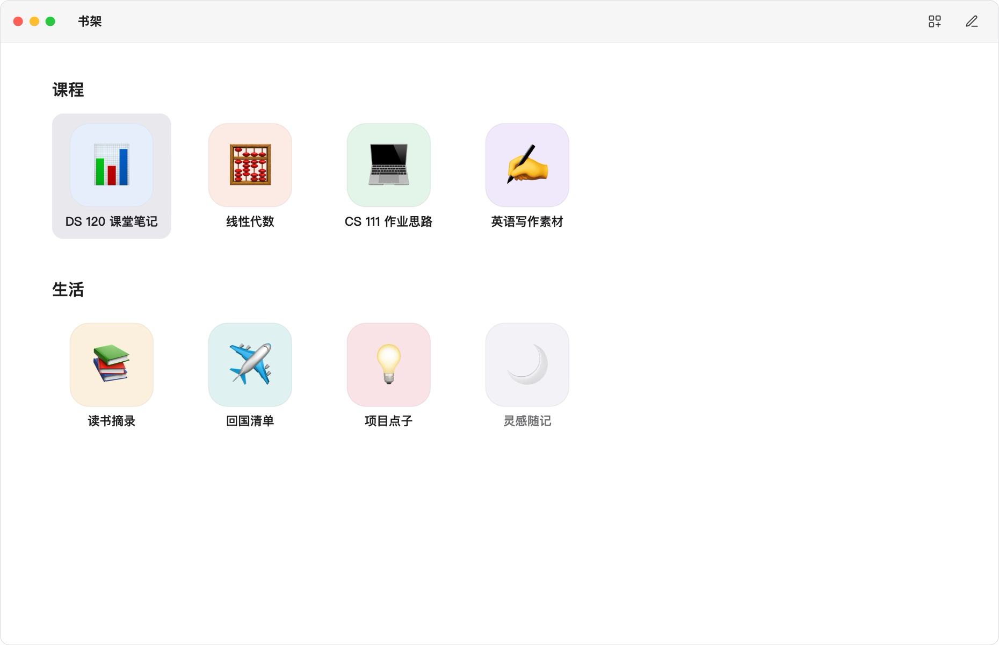
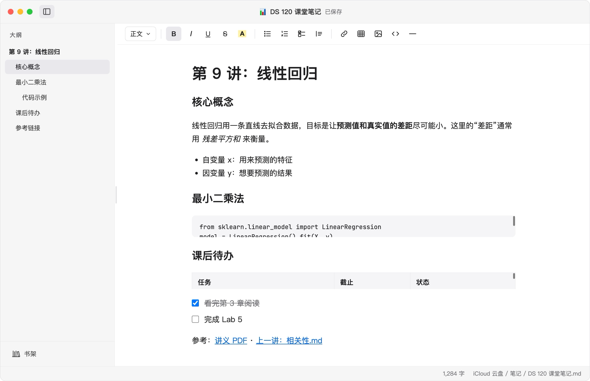
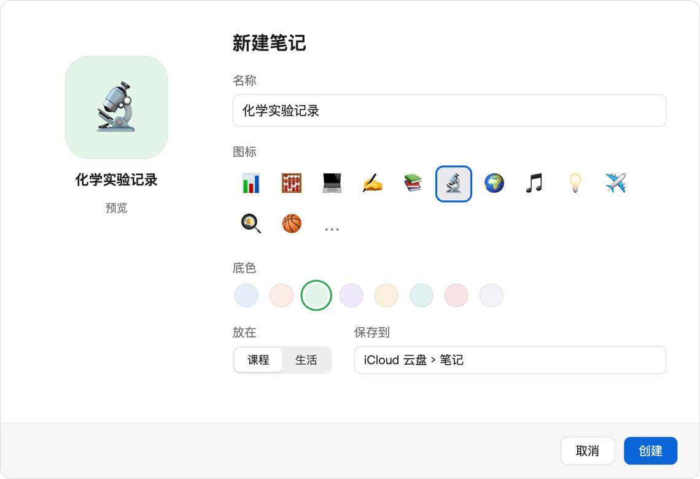

<p align="center">
  
</p>

<h1 align="center">拾记 PikNote</h1>

一个超轻量的 Mac 原生笔记软件：书架是唯一的导航，每篇笔记是一个普通的 .md 文件，写的时候所见即所得，写数学公式不用背 LaTeX。

A lightweight native Mac note app: the bookshelf is your only navigation, every note is a plain .md file, what you see is what you get, and you can write math without memorizing LaTeX.

> 当前版本 / Current version：**1.1.0**

## 特点

- **文件永远是你的**：每篇笔记都是标准的 `.md` 文件，存在你选的文件夹里（可以放在 iCloud 云盘、OneDrive 等任何同步文件夹）。卸掉拾记，笔记一切如常
- **书架**：文件夹里的每个子文件夹就是一层书架，每个文件一个方形表情图标；不常用的移进归档，不删除
- **所见即所得**：标题、列表、待办、表格、引用、代码块、链接、图片，也可以直接打 Markdown
- **公式**：按 ⌘⇧M，用中文、英文或拼音搜公式，回车插入，Tab 跳到下一个空；输出就是标准的 `$...$`
- **图片**：拖进笔记或 ⌘V 粘贴截图，存在书架的 `assets` 文件夹里；选中后 ⌘+ / ⌘- 调大小
- **PDF**：内置查看，页码直跳
- **外观**：浅色 / 深色 / 护眼，中文 / English；标题颜色、底色、字体、行间距都能改

## 界面预览

<p align="center"></p>
<p align="center"><sub>书架：每层书架一个标题，每篇笔记一个表情图标</sub></p>

<p align="center"></p>
<p align="center"><sub>编辑页面：左边大纲，上面格式工具栏，所见即所得</sub></p>

<p align="center"></p>
<p align="center"><sub>公式快捷栏（⌘⇧M）：中文、英文、拼音都能搜，不用背 LaTeX</sub></p>

<table>
  <tr>
    <td align="center"><br><sub>新建笔记：选表情、底色和放在哪层</sub></td>
    <td align="center"><br><sub>外观：浅色 / 深色 / 护眼</sub></td>
  </tr>
</table>

<sub>以上是设计稿，和实际软件在细节上略有不同。</sub>

## 安装

1. 到 [Releases](https://github.com/houyue-9980/PikNote/releases) 下载 `PikNote-1.1.0.dmg`
2. 打开后，把 **PikNote** 拖进“应用程序”
3. 第一次打开：拾记没有经过苹果公证，直接双击会提示“无法验证开发者”。请在“应用程序”里**右键点击 PikNote → 打开**，再在弹窗里点“打开”。之后就能正常双击打开了
   - 如果没有“打开”按钮：打开 **系统设置 → 隐私与安全性**，在下面找到关于 PikNote 的提示，点“仍要打开”
4. 第一次使用时选一个笔记文件夹。选空文件夹的话，会自动建一层书架，放上中英文使用教程

需要 macOS 15 或更新版本。

## Install

1. Download `PikNote-1.1.0.dmg` from [Releases](https://github.com/houyue-9980/PikNote/releases)
2. Open it and drag **PikNote** into Applications
3. PikNote isn’t notarized by Apple, so the first time, **right-click PikNote in Applications → Open**, then click Open. After that it opens normally
4. Choose a notes folder. If it’s empty, PikNote creates a shelf with a short guide in English and Chinese

Requires macOS 15 or later.

## 开发

需要 Xcode、Node.js 和 XcodeGen（`brew install xcodegen`）。

| 位置 | 内容 |
| --- | --- |
| `PikNote/` | Mac 软件的 Swift 代码（SwiftUI） |
| `PikNote/Resources/editor/` | 打包好的网页编辑器（由 `web-editor` 生成，不要手改） |
| `web-editor/` | 网页编辑器源码（Milkdown + 公式、高亮、图片等插件） |
| `project.yml` | Xcode 项目配方，用 XcodeGen 生成 `PikNote.xcodeproj` |
| `tools/make-icon.swift` | 生成软件图标 |
| `tools/run-app.sh` | 编译并重新打开开发版 |

```bash
# 改了 web-editor 后重新打包编辑器
cd web-editor && npm install && npm run build

# 改了 project.yml 或增删了 Swift 文件后重新生成项目
xcodegen

# 编译并打开开发版（开发版的设置和正式版分开存）
tools/run-app.sh
```

## 致谢

- [Milkdown](https://milkdown.dev)：所见即所得的 Markdown 编辑器
- [KaTeX](https://katex.org)：公式渲染
- [XcodeGen](https://github.com/yonaskolb/XcodeGen)：生成 Xcode 项目

## 许可证

[MIT](LICENSE)
